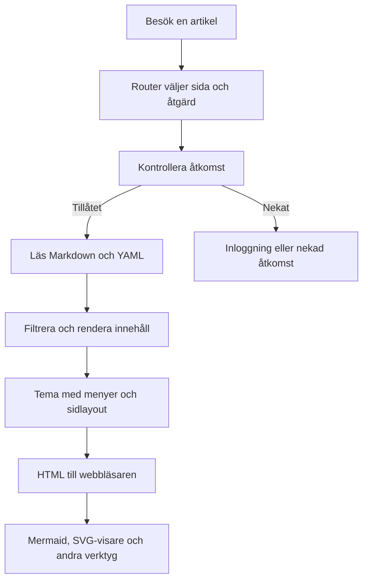
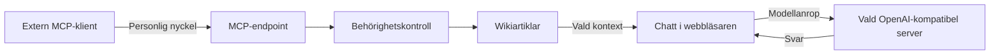

# Så fungerar RuneWiki

[Till README](README.md) · [Alla guider](DOCUMENTATION.md) · [Kodens struktur](STRUCTURE.md)

RuneWiki kombinerar en serverrenderad PHP-wiki med interaktiva verktyg i
webbläsaren. Markdown-filerna är innehållets källa; databasserver behövs inte.

## Från adress till artikel



Renderad HTML kan cachas. Sökindex och cache är hjälpfiler; själva artiklarna
ligger i `content/`. Inloggningskrav per sida och namespace-regler avgör vad
en besökare får läsa. Se [åtkomstguiden](readme-page-access.md).

## Vad ligger var?

```text
runewiki/
+-- content/       Markdown, frontmatter och menyfiler
+-- images/        Uppladdade bilder och SVG
+-- config/        PHP-konfiguration
+-- data/          Historik, kommentarer, konton, cache och index
|
+-- core/          Routing, parsning, behörigheter och lagring
+-- templates/     Tema, HTML, CSS och JavaScript
+-- admin/         Administration och filhantering
+-- chat/          AI-chattens webbklient
+-- mcp/           Endpoint för MCP-klienter
+-- plugins/       Utökningar
+-- skills/        Instruktioner för AI-chatten
+-- tests/         Funktions-, HTTP- och webbläsartester
```

## Tre sätt att arbeta med innehållet

| Väg | Vad händer? |
| --- | --- |
| Artikelredigeraren | Redigerar Markdown, kör den vanliga sparprocessen och hanterar metadata och historik. |
| Adminens fileditor | Läser och skriver råtext, skapar mappar och flyttar filer. Råtexten sparas utan automatisk metadataomskrivning. |
| MCP | Låter en klient lista, söka och läsa tillåtet innehåll med en personlig nyckel. |

Fileditorns flyttfunktion ändrar filens sökväg, inte länkarna i andra artiklar.
Artikelns flyttfunktion har ett annat arbetsflöde; se
[namnbyte och flytt](HANDBOOK.md#byta-namn-och-flytta).

## AI-chatten och MCP har olika anslutningar



Chatten lagrar anslutningsinställningar i webbläsarens IndexedDB och gör
modellanrop därifrån. Vald kontext skickas till den modellserver du ansluter.
MCP använder serverns personliga nycklar och åtkomstkontroller.

Läs [chatt och skills](HANDBOOK.md#ai-chatt-och-skills-chat-skills) för
chattflödet och [MCP-guiden](readme-mcp.md) för klientanslutning.

## För den som vill ändra koden

Börja i [STRUCTURE.md](STRUCTURE.md), som beskriver klasser, routes och
ansvar mer i detalj. Tester ligger i `tests/`; PHP-tester körs med PHP och
webbläsartester kräver Playwright och Edge. Vissa tester behöver CDN-åtkomst
eller startar en isolerad lokal PHP-server.
