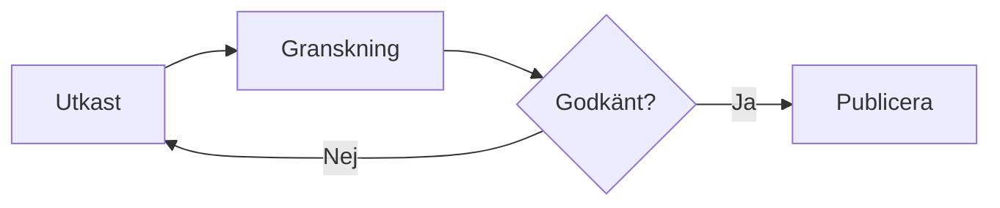

# Exempel: bygg en liten kunskapsbank

[Till README](README.md) · [Kom igång](GETTING_STARTED.md) · [Alla guider](DOCUMENTATION.md)

Här är ett litet upplägg som går att bygga vidare på. Kodexemplen är förslag,
inte filer som automatiskt skapas i installationen.

## En handbok för teamet

```text
                    +-----------------+
                    | Teamets handbok |
                    +--------+--------+
                             |
           +-----------------+-----------------+
           |                 |                 |
     Introduktion         Rutiner          Systemkarta
     Forsta veckan        Checklistor      Diagram & lankar
```

Skapa `content/team/start.md`:

```markdown
---
title: Teamets handbok
tags:
  - team
  - onboarding
page_layout: wide
---

# Teamets handbok

Här hittar du vår introduktion, våra rutiner och en karta över systemen.

- [[team:introduktion|Din första vecka]]
- [[team:rutiner|Så arbetar vi]]
- [[team:system|Våra system]]
```

`page_layout: wide` använder mer bredd och döljer sidomenyn. Välj `fullscreen`
för enbart artikelinnehåll, eller ta bort fältet för vanlig layout.
[Mer om sidlayout](HANDBOOK.md#sidlayout-för-landningssidor).

## En meny med underpunkter

Lägg i `content/_topbar.md`:

```markdown
- [[start|Hem]]
- Teamet
  - [[team:start|Handbok]]
  - [[team:rutiner|Rutiner]]
  - [[team:system|Systemkarta]]
- [Media](/images)
```

**Teamet** blir en dropdown. Vanliga länkar och nästlade listor kan kombineras.
[Mer om toppmenyn](HANDBOOK.md#toppmenyn-_topbarmd).

## Visa ett arbetsflöde med Mermaid

Skriv följande i en artikel:

````markdown

````

Så här ser diagrammet ut:


I RuneWiki kan du öppna diagrammet i fullskärm, zooma och välja **Visa kod**.
Sidopanelen ger liveförhandsvisning; **Spara i artikeln** sparar ändringen om
du har redigeringsrätt. [Mermaid-redigering](readme-editor.md#redigera-mermaid-i-diagramvisaren).

GitHub visar också Mermaid-block direkt i Markdown-filer. Se
[GitHubs diagramdokumentation](https://docs.github.com/en/get-started/writing-on-github/working-with-advanced-formatting/creating-diagrams).

## Bilder och SVG nära texten

```markdown
{{team:oversikt.png?600|Översikt över teamets system}}

```

**Bläddra i media → Redigera SVG** innehåller mallar för sammanfattning,
publiceringsflöde, systemöversikt, tidslinje och ansvarsfördelning.
[SVG-guiden](readme-svg.md) beskriver redigering, sparning och formatstöd.

## Samla feedback

Öppna artikelns **… → Samarbeta och kommentera** för att kommentera delar av
innehållet. Under admin kan du styra om visning och feedback kräver inloggning.
Kommentarerna ligger separat från artikeltexten.
[Läs om samarbete](readme-colab.md).

## En artikel som kräver inloggning

```yaml
---
title: Intern rutin
require_login: true
tags:
  - internt
---
```

Kravet gäller även andra läsvägar som nedladdning och MCP, enligt respektive
åtkomstregler. Se [åtkomstguiden](readme-page-access.md) innan du delar länken.

## Visa de senaste uppdateringarna

Lägg detta på en egen rad i teamets startsida:

```markdown
{{recent#5}}
```

Det visar de fem senast ändrade sidor som besökaren får läsa, som klickbara sidtitlar utan datum. Använd `{{recent}}` för tio sidor. Kommandot finns också via Ctrl+Space.
[Detaljer om datum och sortering](HANDBOOK.md#senast-ändrade-sidor).
