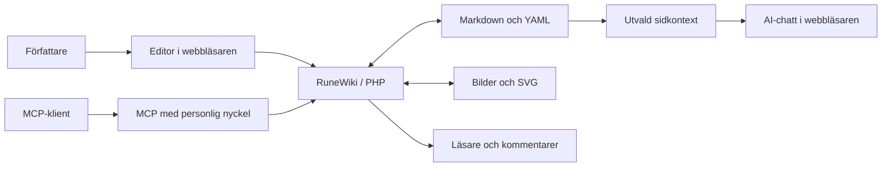

# RuneWiki

### Från Markdown-filer till en gemensam kunskapsbank.

RuneWiki är en databasfri wiki i PHP. Skriv och länka artiklar i webbläsaren,
visualisera med Mermaid och SVG, samla feedback och använd dina sidor som
kontext i AI-chatt. Innehållet ligger kvar som vanliga filer på din server.

**PHP 8.1+ · Markdown + YAML · Ingen databas · MIT**

[Kom igång](GETTING_STARTED.md) · [Se exempel](EXAMPLES.md) · [Dokumentation](DOCUMENTATION.md) · [Så fungerar det](ARCHITECTURE.md)

```text
                     R U N E W I K I
              En kunskapsbank. Vanliga filer.

   +----------------+   +----------------+   +----------------+
   | SKRIV          |   | KOPPLA IHOP    |   | DELA            |
   | Markdown       +-->| Wikilankar     +-->| Artiklar        |
   | Bilder & kod   |   | Diagram       |   | Feedback & AI   |
   +----------------+   +----------------+   +----------------+
                              |
                       content/*.md
                      Ingen databas.
```

## Vad kan jag använda det till?

- **Teamets handbok** — rutiner, onboarding, beslut och kontaktvägar.
- **Teknisk dokumentation** — systemöversikter, kodexempel och diagram nära texten.
- **Projektwiki** — samla underlag, länka mellan sidor och kommentera innehållet.
- **Kunskapskälla för AI** — använd utvalda artiklar i chatten eller anslut en MCP-klient.

## Det här får du

| Område | I RuneWiki |
| --- | --- |
| **Skriv och redigera** | Monaco-editor, Ctrl+Space-förslag, helskärm och import av Markdown, Word, HTML och textbaserad PDF. |
| **Visualisera** | Mermaid med zoom och liveförhandsvisning, SVG-editor med wikimallar och bildstorlekar direkt i Markdown. |
| **Hitta och länka** | Sökning, taggar, wikilänkar, bakåtlänkar, rubrikbokmärken, menyer med underpunkter och listor över senast ändrade sidor. |
| **Samarbeta** | Kommentarer kopplade till artikelblock, med separata inställningar för läsning och feedback. |
| **Använd AI** | Klientdriven chatt med sidkontext, skills och en OpenAI-kompatibel modellanslutning. |
| **Anslut verktyg** | MCP-server med personliga nycklar för att lista, söka och läsa innehåll. |
| **Administrera** | Rå fileditor, mappar, flervalsuppladdning, versionshistorik, ZIP-export och import i delar. |
| **Styr åtkomst** | Lokala konton, OIDC och AD/LDAP, namespace-behörigheter, skyddade namespaces via admin och inloggningskrav per sida. |

## Så hänger det ihop



Wikiartiklarna finns i `content/`, media i `images/` och historik,
kommentarer och annan driftdata i `data/`. AI-chatten ansluter från webbläsaren
till den modellserver du väljer. MCP-anrop går genom serverns åtkomstkontroller.

## Prova lokalt

Du behöver PHP 8.1+ med `mbstring`, Git och en webbläsare.

```bash
git clone https://github.com/yllemo/runewiki.git
cd runewiki
cp config/config.example.php config/config.php
php -S 127.0.0.1:8080 index.php
```

Öppna [localhost:8080](http://127.0.0.1:8080/). Kopieringssteget gäller en ny
installation; behåll din befintliga `config/config.php` vid uppdatering.

Monaco, Mermaid och vissa importfunktioner laddar bibliotek från CDN.
ZIP, SVG och externa inloggningsmetoder kräver ytterligare PHP-tillägg.
[Installationsguiden](GETTING_STARTED.md) beskriver kraven, första kontot
och driftsättning med Apache.

## En artikel är en fil

Spara exempelvis `content/team/start.md`:

```markdown
---
title: Teamets handbok
tags:
  - team
  - onboarding
---

# Välkommen till teamet

Börja med [[team:rutiner|Våra rutiner]].

## Första veckan

- [ ] Läs introduktionen
- [ ] Boka ett möte med din handledare
```

Sidan får adressen `/team/start`. Du kan arbeta i wiki-editorn eller med
filerna direkt. Det är lätt att läsa innehållet även utan RuneWiki.

[Se fler exempel: diagram, menyer och landningssidor →](EXAMPLES.md)

## Håll kunskapsbanken aktuell

Visa nyligen ändrade sidor direkt på startsidan eller i en artikel:

```markdown
{{recent#10}}
```

Listan **Senast ändrat** visar sidtitlar som klickbara länkar för upp till tio
sidor som besökaren får läsa. Byt antalet till 1–100; utan `#antal` används tio.
Fältet `updated` sätts automatiskt när artikelinnehåll eller metadata ändras,
när automatiska tidsstämplar är aktiverade (standard).
[Mer om listan och datumen](HANDBOOK.md#senast-ändrade-sidor).

Under **Admin → Inloggning → Skyddade namespaces** kan exempelvis `internt`
kräva inloggning på alla artikelns läsvägar, inklusive sökning och chatt.
MCP kräver då en personlig nyckel som tillåter inloggat innehåll (`ifAuth`).
Det gäller även om global redigeringsinloggning är avstängd. Direktlänkade
bilder i `images/` omfattas inte. [Läs om skyddade namespaces](readme-page-access.md#skyddade-namespaces).

## Välj nästa steg

| Jag vill… | Börja här |
| --- | --- |
| Installera och skapa mitt första konto | [Kom igång](GETTING_STARTED.md) |
| Se konkreta exempel innan jag installerar | [Exempel och arbetsflöden](EXAMPLES.md) |
| Förstå lagring, rendering och AI-anslutningar | [Arkitekturöversikt](ARCHITECTURE.md) |
| Ansluta en MCP-klient | [MCP-guiden](readme-mcp.md) |
| Konfigurera OIDC eller AD | [Inloggningsguiden](readme-auth.md) |
| Flytta en wiki mellan installationer | [Export och import](readme-import.md) |
| Hitta en inställning eller syntaxdetalj | [Handboken](HANDBOOK.md) |
| Hitta alla guider | [Dokumentationsindex](DOCUMENTATION.md) |

## Bra att känna till

RuneWiki är en serverapplikation som behöver PHP och skrivbara lagringsmappar.
Det är inte en statisk GitHub Pages-webbplats. AI kräver en egen modellanslutning;
PDF-import gör ingen OCR. Råa filflyttar under admin uppdaterar inte länkar i
andra artiklar. Se [handbokens begränsningar](HANDBOOK.md#kända-begränsningar).

## Bidra

Felrapporter och förbättringsförslag är välkomna via
[GitHub Issues](https://github.com/yllemo/runewiki/issues). Beskriv gärna vad du
förväntade dig, vad som hände och hur det går att återskapa.

För kodändringar: börja med [projektstrukturen](STRUCTURE.md) och kör relevanta
tester i `tests/`. Skicka inte med lokala konton, nycklar eller privat wikiinnehåll.

## Licens

RuneWiki är öppen källkod under [MIT-licensen](LICENSE).
