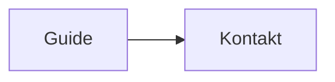

# Helskärm och filimport i editorn

För SVG finns **Bläddra i media → Redigera SVG** med kodfält, förhandsvisning och sparning
till media. Se [SVG-guiden](readme-svg.md).

Öppna en artikel med **Redigera**. **Helskärm** låter editorn fylla hela
webbläsarens yta med verktygsraden och Spara kvar. Välj **Avsluta helskärm**
eller tryck Escape för att återgå. Texten och markörpositionen bevaras.

## Bilder och SVG i media

**Bläddra i media** öppnar bildväljaren. Sökfält och stängknapp ligger överst;
**Ladda upp bild** och **Redigera SVG** finns på en egen rad. Välj en miniatyr
för att infoga bilden vid markören. SVG-redigeraren behåller artikelns markering,
så ett befintligt `svg`-kodblock kan öppnas och ändras därifrån.

I den separata **Mediahanteraren** visas målmapp vid uppladdningen, filantal
och filer grupperade per mapp. Filkorten visar hela bilden utan beskärning,
filnamn, storlek, inbäddningskod och referenser. Redigera SVG och Ta bort
visas efter samma behörigheter som tidigare.

## Sidlayout via frontmatter

Använd `page_layout: wide` för en bred artikel utan sidomeny eller
`page_layout: fullscreen` för enbart artikelinnehåll utan navigation,
sidfot och sidverktyg. `page_layout: default` återställer vanlig layout.
Fältet ska ligga mellan sidans inledande `---`-rader.

Detta styr artikelvyn, inte editorns helskärmsknapp. Redigeraren behåller
sin vanliga layout; öppna den med `?do=edit` om sidverktygen är dolda.
Se [sidlayout för landningssidor](README.md#sidlayout-för-landningssidor)
för ett komplett exempel och inställningar för Ctrl+Space.

## Bildstorlekar

Ange storleken i pixlar direkt efter bildnamnet:

```markdown
{{projekt:bild.png?300|Beskrivning}}
{{projekt:bild.png?300x200|Beskrivning}}


```

`?300` ger 300 pixlars bredd med proportionell höjd. `?300x200` anger en
bildyta på 300 × 200 pixlar: hela bilden ryms utan beskärning eller förvrängning.
Bildytan krymper proportionellt om skärmen är smalare. Storleken ändrar bara
visningen; originalfilen och lightboxen behålls. Värden från 1 till 9999 stöds.
Ctrl+Space innehåller förslag för båda storleksformaten.

## Rubriklänkar och läsläge

Rubriker får automatiska bokmärken: `## Kom igång` ger `#kom-igång`.
I artikelvyn visas en länkikon när musen är över rubriken eller länken får
tangentbordsfokus. Använd exempelvis `[[guide#kom-igång|Kom igång]]` eller
`[Kom igång](/guide#kom-igång)`. Upprepade rubriker får numrerade suffix.
Rubrikbyte ändrar bokmärket. I **Läs- och exportläge** och dess exporter tas
ikonerna bort, medan rubrikernas ID:n och innehållsförteckningens länkar bevaras.

## Versionshistorik

Som standard behålls 10 tidigare versioner per sida, utöver den aktuella filen.
Ändra `'history_max_versions' => 10,` i `config/config.php` för en annan gräns.
Saknad inställning eller värden under 1 ger 10. Gamla versioner rensas när
nästa snapshot skapas för sidan; även säkerhetskopior vid återställning och
flytt räknas in. Befintliga historikfiler fungerar även efter uppdateringen.

## Importera ett dokument

1. Välj **Importera fil** i editorns verktygsrad.
2. Välj en fil och vänta på konverteringen.
3. Granska och vid behov redigera Markdown-texten i förhandsgranskningen.
4. Välj **Infoga vid markören** (ersätter eventuell markering) eller
   **Ersätt hela innehållet**. Det senare kräver bekräftelse och ersätter även
   YAML-frontmatter. Avbryt importen med krysset eller Escape.
5. Kontrollera innehållet i editorn och välj **Spara** som vanligt.

Importen sparar inte automatiskt. Ctrl+Z ångrar en infogning eller ersättning.
Om konverteringen misslyckas finns den befintliga texten kvar.

| Format | Resultat och begränsningar |
|---|---|
| `.md`, `.markdown` | Markdown inklusive metadata importeras som text. |
| `.txt` | Text läses som UTF-8. |
| `.html`, `.htm` | Rubriker, listor, länkar, formatering och enkla tabeller blir Markdown. Aktivt HTML-innehåll tas bort. Bilder blir eventuell alternativtext. |
| `.docx` | Word konverteras till Markdown. Bilder importeras inte; komplex layout och tabeller kan behöva justeras. Äldre `.doc` stöds inte. |
| `.pdf` | Text hämtas sida för sida. Läsordning, spalter och tabeller kan behöva korrigeras. Skannade sidor kräver OCR i ett annat verktyg före import; tomma sidor hoppas över med besked. |

Maximal filstorlek är 25 MB, PDF får ha högst 200 sidor och resultatet får
innehålla högst 2 miljoner tecken. Import sker i webbläsaren; dokumentet skickas
inte till en konverteringstjänst eller PHP-servern. Den vanliga sparfunktionen
och dess åtkomstregler används när du sparar Markdown-texten.

## Teknik och drift

`templates/default/assets/js/editor-tools.js` hanterar helskärm, konvertering,
förhandsgranskning och Monacos undo-historik. Importbiblioteken laddas vid behov
från jsDelivr med låsta versioner: [Mammoth](https://github.com/mwilliamson/mammoth.js)
1.13.0, [Turndown](https://github.com/mixmark-io/turndown) 7.2.5 och
[PDF.js](https://github.com/mozilla/pdf.js) 6.5.438 med samma version för worker.
Webbläsaren behöver tillgång till CDN:en, liksom för Monaco. Ingen extra
PHP-konverterare eller serverinstallation krävs. Anpassad Content Security Policy
måste tillåta dessa skript och PDF.js worker (inklusive blob-worker).

Webbläsartest: `node tests/editor-tools.cjs` från projektroten, med Playwright,
Edge och tillgång till CDN. Testet använder syntetiska dokument och kontrollerar
konvertering, förhandsgranskning, infogning, undo samt helskärm på desktop/mobil.

## Redigera Mermaid i diagramvisaren

Öppna ett Mermaid-diagram i fullskärm och välj **Visa kod**. På en wikiartikel
med redigeringsbehörighet kan du ändra koden och välja **Spara i artikeln**.
**Stäng** eller Escape sparar också ändrad kod när kodpanelen är öppen.
**Avbryt** stänger kodpanelen och kastar ändringarna. Syntaxfel och sparfel
visas i panelen utan att koden försvinner.

Sparningen använder artikelns behörigheter, CSRF-skydd, versionshistorik,
plugins och automatiska tidsstämplar. Om sidan har ändrats sedan den öppnades
nekas sparningen: kopiera koden och ladda om sidan. Identiska diagramblock
eller block inuti listor kan behöva ändras i den vanliga artikelredigeraren.
I chatt, läsvyer utan artikelkoppling och för användare utan redigeringsrätt
är kodpanelen skrivskyddad.

Vanliga Mermaid-länkar fungerar även i fullskärm, exempelvis:



HTTP-, HTTPS- och mailto-länkar stöds. JavaScript-callbacks aktiveras inte.
Dra i diagrammets övriga yta för panorering; klick på en länk öppnar länken.
